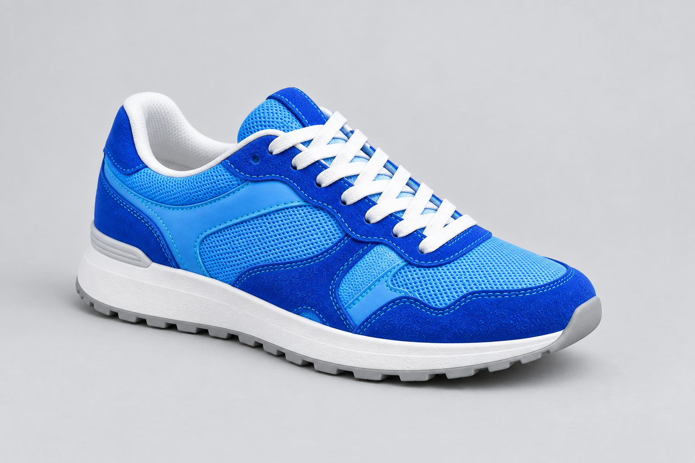
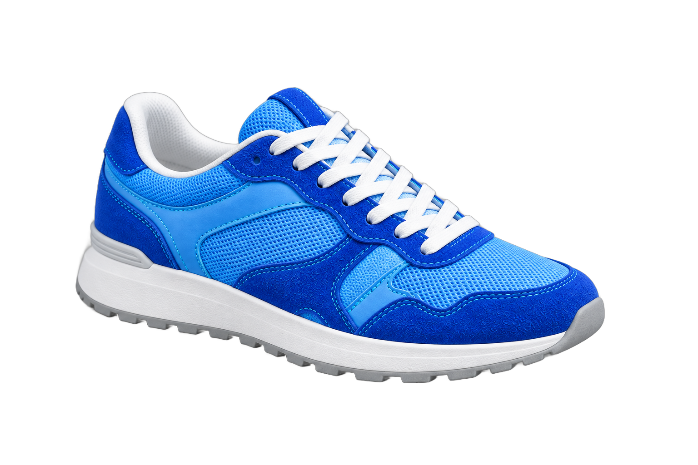

# Mattevia — Background Removal Guides & Examples

Practical workflows for transparent images, white-background product photos, and iPhone HEIC cutouts.

[Try Mattevia](https://mattevia.com) · [中文说明](README.zh-CN.md)

## Start with your goal

| Goal | Guide | Online tool |
| --- | --- | --- |
| Export a transparent PNG or WebP | [Transparency guide](guides/transparent-images.md) | [Transparent background maker](https://mattevia.com/transparent-background) |
| Prepare a white-background product photo | [Product photo guide](guides/white-background.md) | [White background tool](https://mattevia.com/white-background) |
| Work with an iPhone HEIC photo | [HEIC workflow](guides/heic-workflow.md) | [HEIC background remover](https://mattevia.com/heic-background-remover) |
| Check hair, fur and product edges | [Quality checklist](guides/quality-checklist.md) | [Mattevia](https://mattevia.com) |

## Before and after

These are fictional AI-generated demonstration images. The transparent results were produced through Mattevia on September 9, 2026, without manual retouching. They illustrate individual outputs, not a quality benchmark or a guarantee for other photos. See [provenance](examples/SOURCES.md).

| Subject | Original | Transparent result |
| --- | --- | --- |
| Product |  |  |
| Portrait |  |  |
| Pet |  |  |

A viewer may display transparent pixels on white. Open a result on a dark or colored canvas to inspect its edges.

## A useful first workflow

1. Upload one clear image with the whole subject in frame.
2. Remove the background and compare the result with the original.
3. Inspect light and dark backgrounds before choosing your final color.
4. Select PNG or WebP for transparency; JPG uses a solid background.
5. Check the reported output dimensions, download, and reopen the saved file.

Fine hair, glass, reflections and translucent objects may lose detail. Changing export format or background color cannot repair a missing part. The current workspace processes one image at a time; it has no batch upload or ZIP export.

## Contribute

See [CONTRIBUTING.md](CONTRIBUTING.md) for corrections and example submissions. Please do not post private photos, credentials, or images you cannot share publicly.

## About this repository

Maintained by Mattevia. This repository contains guides and demonstration assets, not the source code, model weights, or a public API SDK for the hosted service. Product behavior can change; check the live tool for current limits.
